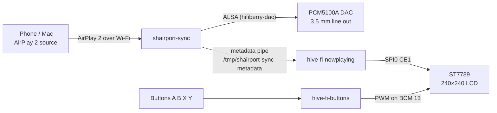

# hive-fi

An AirPlay 2 speaker built from a Raspberry Pi Zero 2 W and a
[Pirate Audio: Line-out](https://shop.pimoroni.com/products/pirate-audio-line-out).

[shairport-sync](https://github.com/mikebrady/shairport-sync) receives the audio and
sends it out of the line-out jack. The scripts in this repository drive the front
panel: album art and track details on the 240×240 LCD, and the four buttons down
the side.



## What is on screen

`hive-fi-nowplaying` reads the metadata pipe published by shairport-sync and
redraws the panel as tracks change:

- **Cover art** from the AirPlay source, scaled and centre-cropped to fill the panel.
- **Title, artist and album**, over a gradient that keeps the text legible on light
  artwork. Lines too long for 240 pixels scroll back and forth.
- **A progress bar** with elapsed and total time, interpolated between the progress
  messages the source sends.
- **A pause badge** when playback is paused.
- **A volume bar**, shown briefly down the right-hand edge when the volume changes.
- **The hive-fi logo** whenever nothing is playing.

## Hardware

| Part | Detail |
| --- | --- |
| Computer | Raspberry Pi Zero 2 W |
| HAT | Pirate Audio: Line-out (PCM5100A DAC, 1.3" 240×240 ST7789 IPS LCD, four buttons) |
| Audio out | 3.5 mm line level |
| OS | Raspberry Pi OS Bookworm or later, 64-bit |

Full pinout and boot configuration: **[docs/hardware.md](docs/hardware.md)**.

## Getting started

1. **[docs/hardware.md](docs/hardware.md)** — wire it up and enable SPI and the DAC overlay.
2. **[docs/shairport-sync.md](docs/shairport-sync.md)** — build shairport-sync for AirPlay 2
   *with metadata*, and turn the pipe on. The distribution packages will not do.
3. **[docs/installation.md](docs/installation.md)** — install the Python dependencies and
   the three systemd services.
4. **[docs/services.md](docs/services.md)** — what each service does, how to configure it,
   and what to check when something is wrong.

The short version, once shairport-sync is running:

```bash
git clone https://github.com/CameronWragg/hive-fi.git ~/hive-fi
cd ~/hive-fi
python3 -m venv --system-site-packages .venv
.venv/bin/pip install -r requirements.txt
sudo ./install.sh
```

## Buttons

| Button | GPIO | Action |
| --- | --- | --- |
| A | BCM 5 | Unassigned |
| B | BCM 6 | Cycle the backlight: 50% → 75% → 100% → off → 25% |
| X | BCM 16 | Shut down |
| Y | BCM 24 | Reboot |

## Repository layout

```
bootlogo/     one-shot service that paints the logo at boot
buttons/      button and backlight handling
nowplaying/   the shairport-sync metadata display
docs/         setup and reference documentation
install.sh    fills in the unit file placeholders and installs the services
```

Each directory holds its script alongside the systemd unit that runs it. The units
contain `__HIVE_FI_*__` placeholders rather than real paths — `install.sh` substitutes
the repository location, the account to run as, and the Python interpreter, because
Raspberry Pi OS no longer ships a user called `pi`.

## Development

`hive-fi-nowplaying` can run on a normal computer with nothing but Pillow installed.
Point it at a FIFO of your own and ask it to write frames to a PNG instead of the LCD:

```bash
mkfifo /tmp/fake-metadata
./nowplaying/hive-fi-nowplaying.py \
    --pipe /tmp/fake-metadata --preview /tmp/frame.png --log-level DEBUG
```

Anything written to that FIFO in the shairport-sync metadata format will be parsed and
drawn. The format is documented in
[docs/shairport-sync.md](docs/shairport-sync.md#the-metadata-format).

## Licence

GPL-3.0. See [LICENSE](LICENSE).
