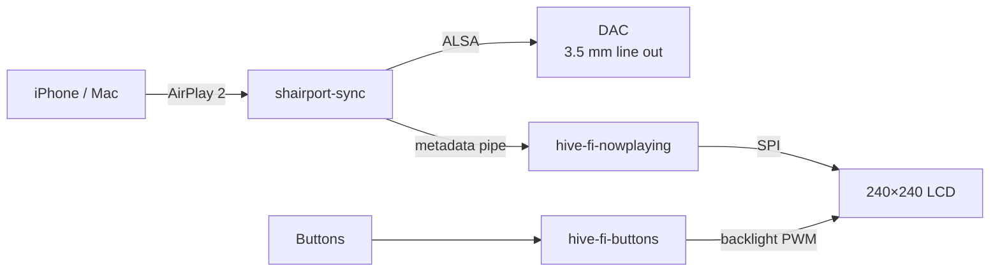

# hive-fi

An AirPlay 2 speaker built from a Raspberry Pi Zero 2 W and a
[Pirate Audio: Line-out](https://shop.pimoroni.com/products/pirate-audio-line-out) HAT.

[shairport-sync](https://github.com/mikebrady/shairport-sync) plays the audio. This
repository drives the front panel: now-playing info on the 240×240 LCD, and the four
buttons.



The display shows cover art, title, artist and album (long lines scroll), a progress
bar, a pause badge, a brief volume bar on changes, and the hive-fi logo when idle.

## Setup

1. [Hardware](docs/hardware.md): enable SPI and the DAC overlay.
2. [shairport-sync](docs/shairport-sync.md): build it for AirPlay 2 *with metadata*.
   The distribution packages won't do.
3. [Installation](docs/installation.md): install the Python dependencies and services.

[Services](docs/services.md) covers configuration and troubleshooting.

## Buttons

| Button | Action |
| --- | --- |
| A | Unassigned |
| B | Cycle the backlight: 50% → 75% → 100% → off → 25% |
| X | Shut down |
| Y | Reboot |

## Layout

```
bootlogo/     one-shot service that shows the logo at boot
buttons/      buttons and backlight
nowplaying/   the now-playing display
docs/         setup and reference
install.sh    installs the systemd units
```

## Development

`hive-fi-nowplaying` runs on any machine with Pillow. Feed it a FIFO and render to a
PNG instead of the LCD:

```bash
mkfifo /tmp/fake-metadata
./nowplaying/hive-fi-nowplaying.py --pipe /tmp/fake-metadata --preview /tmp/frame.png
```

Write items in the [metadata format](docs/shairport-sync.md#metadata-format) to the
FIFO to drive it.

## Licence

GPL-3.0. See [LICENSE](LICENSE).
